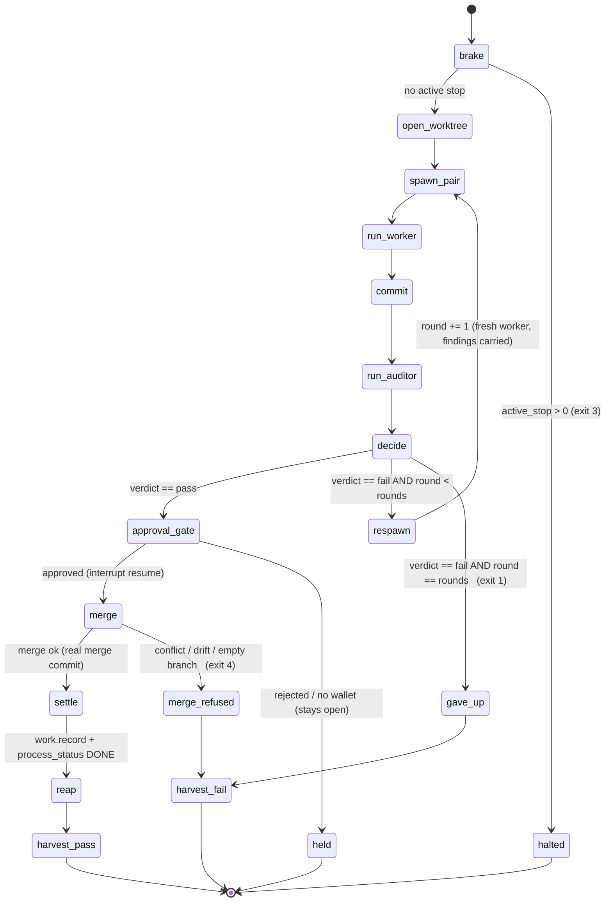

# Modeling the Ticket-Authorization Lifecycle as a LangGraph State Machine

**Ticket:** #172 (rfc-investigation). LAST research gate in the `local-agent-stack` tier. Unblocks build **#177** (the LangGraph orchestrator).
**Date:** 2026-07-15
**Status:** GROUNDED — mapped against the real control flow in `congruency/tools/pair_loop.py` (1137 lines, read in full), the governed REST routes, and the append-only `ticket_events` ledger; LangGraph APIs confirmed against the official LangChain/LangGraph docs (cited §7).
**Builds ON (cited, not re-derived):** #173 `role_model_fit.md` (dispatch=gemma3:27b w/ harness-precomputed stop/gate flags; worker=qwen2.5-coder / qwen3-coder; judge=gemma3:27b), #175 `ollama_structured_output_reliability.md` (JSON-Schema-constrained `format` is the 100% structured channel; gemma3 takes NO `tools` array; validate-and-retry wrapper), #174 `mcp_tool_access_least_privilege.md` (per-role MCP-server selection; worker code via codebean; harness holds the governance writes).

---

## 1. Summary / Recommendation

**Gate verdict: PASS.**

LangGraph *can* model pair_loop's lifecycle cleanly as a `StateGraph`, and it buys two things pair_loop does not have today: (a) **durable in-flight cursor state** (which round, which worktree, current node) so a run killed mid-flight resumes exactly where it stopped, and (b) a **first-class human-in-the-loop pause** (`interrupt()`) for an approval gate. But pair_loop is 1137 lines of *tested* control flow (`--selftest` drives the full branch/worktree/commit/merge/reap flow, including parallel pairs, a deliberate merge conflict, an empty branch, and exotic deliverable names, all in a throwaway repo). Rewriting all of it as a graph is high-risk for low marginal return on the Claude path, which already works.

**Recommendation: do NOT adopt LangGraph wholesale. Keep pair_loop's proven `Forge` (git layer) and governed-route calls exactly as they are, and introduce a LangGraph `StateGraph` ONLY as the orchestration shell for the local-model (Ollama) flows built in #176/#178/#179 — the flows that do not exist yet and therefore carry no rewrite risk.** The graph's nodes call the *same* `Forge` methods and the *same* governed REST routes pair_loop calls today; LangGraph adds the checkpointer and the interrupt, nothing more. This gets checkpointing + interrupt exactly where they matter (the new, long-running, resumable local-agent runs) without touching the battle-tested Claude path.

**Checkpoint-vs-ledger verdict: COMPLEMENT, not duplicate.** The append-only `ticket_events` ledger stays the durable **source of truth for settled facts** (what was produced, merged, judged, recorded — permanent, append-only, governance-backed). The LangGraph checkpoint holds only the **volatile in-flight cursor** (current node, round counter, worktree handle, last verdict) — the scratch state that today lives nowhere and is lost when a run dies. They store disjoint things. See §4.

---

## 2. The lifecycle today (from pair_loop.py + the DB)

### 2.1 The states, transitions, and outcomes (extracted from the code, not the docstring alone)

`main()` (pair_loop.py:920) runs ONE ticket through this sequence. Kind→pattern/roles come from `kind.roster` (verified live: `build`/`bug`/`documentation`/`bet` are `pair`; `rfc-investigation`/`spec`/`design`/`audit`/`test`/`stop`/`start` are `solo`). The loop refuses any non-`pair` kind (pair_loop.py:997).

| # | State | What happens | Governed-route / git effect | Outcomes |
|---|---|---|---|---|
| 1 | **BRAKE** | `ticket.stops` → `active_stops`; if `>0`, HALT | read `ticket.stops` | `active_stops>0` → **exit 3 (halted)**; else continue |
| 2 | **OPEN worktree** | `forge.open_worktree(tid, base)` — branch `ticket/<id>` off base, checked out in `<repo>/.git/pair-worktrees/ticket-<id>`. **Idempotent/resumable**: reuses an existing branch+worktree. | `ticket.progress` (agent `forge-t<id>`) | created / reopened(resumed); base-missing → Unexpected |
| 3 | **PAIR (per round)** | register fresh `worker`+`auditor` (`<role>-t<id>r<rnd>`), `ticket.assign` both, `process_status ACTIVE` | `agent.register`×2, `ticket.assign`×2, `process_status` | fresh spawn = cleared memory |
| 4 | **WORK** | `spawn_claude(worker_prompt, worker_tools, timeout, worktree)` → `{"done":true,"ref":...}` on last line | `ticket.progress` | not-done / no-JSON / timeout → Unexpected (**exit 2**) |
| 5 | **COMMIT** | `forge.commit_deliverable` stages ONLY the deliverable, commits on the branch; reports `strays` | `ticket.progress` | byte-identical → `committed:false` (not a crash) |
| 6 | **VALIDATE** | `spawn_claude(auditor_prompt, auditor_tools, …)` BLIND to worker reasoning → `{"verdict":"pass"|"fail","findings":[...]}` | `ticket.progress` | pass / fail |
| 7 | **SETTLE** | see conditional edges below | see below | pass→merge; fail→respawn; merge-refused→exit 4 |

### 2.2 The conditional transitions (the branch logic, pair_loop.py:1024–1127)

- **`verdict==pass` → MERGE.** `forge.merge_to_base` — `git merge --no-ff`. `ok=True` ONLY if a real merge commit exists (HEAD moved + 2 parents), never on git's exit code (an empty branch merges "Already up to date" and moves nothing).
  - merge `ok` → `work.record` (permanent UID), `process_status DONE` (**db refuses DONE without two distinct agents in two distinct roles** — trigger `tg_tickets_pair_completion`, migration 0029), `reap_worktree`, `harvest` lesson → **exit 0 (settled)**.
  - merge NOT ok (conflict / drifted base #213 / **empty branch**) → journal refusal, branch+worktree PERSIST, ticket stays open → **exit 4**.
- **`verdict==fail` & rounds left** → append findings, loop: **respawn a FRESH worker** (findings injected into its birth prompt); the branch keeps every round's commits.
- **rounds exhausted** → journal, branch+worktree kept unmerged, `harvest` → **exit 1 (gave up)**.
- **active stop at BRAKE** → **exit 3 (halted)**.

### 2.3 What persists today — and what does NOT

pair_loop **persists nothing volatile between rounds except through git + the DB routes** (module docstring policy 7; code confirms):

- **git** holds settled *work*: each round's commit on `ticket/<id>`, the merge commit on base.
- the **append-only `ticket_events` ledger** (via `ticket.progress` / `work.record` / `process_status`, attributed to `forge-t<id>`) holds settled *facts*: branch opened, committed, verdict, merged, DONE, lesson.
- **The in-flight cursor is NOT persisted anywhere.** The round counter (`for rnd in range(1, a.rounds+1)`), the accumulated `findings`/`history` lists, and "which node am I on" live only in the Python process's stack. **If the process is killed mid-run, that cursor is lost.** Re-running recovers *partially* by idempotence — `open_worktree` reuses the branch+worktree, `ticket.assign` is resumable (migration 0033) — but the **round counter resets to 1** and the prior rounds' `findings` are gone from memory (they are on the ledger, but `main()` never reads them back to reconstruct `history`). A ticket killed on round 2 of 3 restarts at round 1. **This is precisely the gap a checkpointer closes.**

---

## 3. Node/edge model (the StateGraph)

The lifecycle maps directly onto a LangGraph `StateGraph`. State is a `TypedDict` carrying the **volatile cursor only** (see §4); every node calls the same `Forge` methods and governed routes pair_loop uses today.



**Nodes** (`builder.add_node(name, fn)`), each a thin wrapper over existing code:

| Node | Calls (unchanged from pair_loop) |
|---|---|
| `brake` | `rows("ticket.stops", …)` |
| `open_worktree` | `forge.open_worktree`; `ticket.progress` |
| `spawn_pair` | `agent.register`×2, `ticket.assign`×2, `process_status ACTIVE` |
| `run_worker` | `spawn_*` (Claude → `spawn_claude`; local → the #176 Ollama adapter); `ticket.progress` |
| `commit` | `forge.commit_deliverable`; `ticket.progress` |
| `run_auditor` | `spawn_*` (blind auditor); `ticket.progress` |
| `decide` | pure routing fn (no side effect) — read `state["verdict"]`, `state["round"]`, `state["rounds"]` |
| `approval_gate` | `interrupt(...)` — §5 |
| `merge` | `forge.merge_to_base`; on ok `work.record` |
| `settle` | `process_status DONE`; `ticket.progress` |
| `reap` | `forge.reap_worktree`; `ticket.progress` |
| `respawn` | increment `state["round"]`, append findings → back to `spawn_pair` |
| `harvest_pass` / `harvest_fail` | `harvest(...)` → `ticket.lesson` |

**Conditional edges** (`builder.add_conditional_edges(source, router_fn, {branch: dest})`):

- `add_conditional_edges("brake", brake_router, {"clear": "open_worktree", "halt": "halted"})`
- `add_conditional_edges("decide", verdict_router, {"pass": "approval_gate", "respawn": "respawn", "exhausted": "gave_up"})`
- `add_conditional_edges("approval_gate", approval_router, {"approved": "merge", "rejected": "held"})`
- `add_conditional_edges("merge", merge_router, {"ok": "settle", "refused": "merge_refused"})`
- plain `add_edge` for the linear spans (`open_worktree→spawn_pair→run_worker→commit→run_auditor→decide`, `respawn→spawn_pair`, `settle→reap→harvest_pass→END`).

The terminal nodes (`halted`, `merge_refused`, `gave_up`, `held`, `harvest_pass`) map onto pair_loop's exit codes 3 / 4 / 1 / (new) / 0.

---

## 4. Checkpoint vs the append-only ledger — the key question, answered

**They COMPLEMENT. They store disjoint categories of information, at different durability tiers, for different owners.**

LangGraph persistence works by snapshotting the graph's **channel state** into a **checkpoint** after each super-step, keyed by a `thread_id` in `config={"configurable":{"thread_id": ...}}`; a `BaseCheckpointSaver` (e.g. `InMemorySaver`, `SqliteSaver`) writes those checkpoints, and a resumed run replays from the latest one (docs §7). That is a *process-recovery* mechanism, not a system-of-record.

| | **`ticket_events` ledger (DB)** | **LangGraph checkpoint** |
|---|---|---|
| Holds | **Settled FACTS**: branch opened, deliverable committed (sha), verdict + findings, merged (merge sha), DONE, work UID, lesson | **Volatile CURSOR**: current node, `round` counter, `worktree` path, `base`, last `verdict`, accumulated `findings`/`history`, `deliverable`, `tid` |
| Durability | Permanent, **append-only, never rewritten** (governance invariant; the whole system is built not to erase) | Ephemeral scratch; superseded each super-step; discardable once the run reaches an end node |
| Owner / writer | The harness, via **governed REST routes** (`forge-t<id>` holds the git pen); db triggers enforce invariants | LangGraph runtime, automatically, per super-step |
| Source of truth for | "What is *true* about this ticket" | "Where in the run *am I*" |
| If deleted | Catastrophe — history lost | Harmless — a running ticket just cannot auto-resume; you re-run (as pair_loop does today) |

**Why this is complement, not duplication:** the checkpoint would only *duplicate* the ledger if it were treated as authoritative for settled facts. It must not be. Concretely:

1. **The checkpoint never becomes a settlement authority.** `process_status DONE` still flows through the governed route and is still gated by `tg_tickets_pair_completion` (two distinct agents, two distinct roles). A checkpoint that says "node=settle" proves nothing to the DB — only the pair-completion trigger can mint DONE. So the safety-critical fact lives *only* in the ledger, exactly as today.
2. **The checkpoint holds what the ledger deliberately does not: the reconstructable-but-not-reconstructed cursor.** Today the round counter and `history` list vanish on a kill (§2.3). They *could* be rebuilt by parsing the journal (`harvest_settled` at pair_loop.py:660 already parses verdicts back out of `ticket.journal` — proof it is possible but awkward). The checkpoint stores that cursor directly, so resume is O(1) and exact instead of a fragile journal re-parse.
3. **The two are cross-checkable, which is a feature.** On resume, the graph reads its checkpoint for the cursor; the *facts* it acts on (does the branch exist? is it ahead of base?) are re-derived from git + the ledger, which remain authoritative. If they disagree (e.g. checkpoint says round 2 but the ledger shows the ticket already merged), the ledger/git win and the run short-circuits to the terminal state. The idempotent `open_worktree` / resumable `ticket.assign` already embody "trust the durable state, not the cursor."

**Rule for #177:** *DB is the durable source of truth for settled facts; the LangGraph checkpoint is a resume cursor only. No node may read a settled fact from the checkpoint that it could instead read from the ledger or git.* This keeps the append-only ledger the single system-of-record and makes the checkpoint pure convenience — deletable without data loss.

---

## 5. Interrupt / approval gate

The `approval_gate` node is a wallet/human approval checkpoint placed **between a passing verdict and the irreversible merge** — the point where value/authority is about to be committed (money, or landing work on base). LangGraph's dynamic `interrupt()` (from `langgraph.types`) is the fit:

```python
from langgraph.types import interrupt, Command

def approval_gate(state: LifecycleState) -> dict:
    decision = interrupt({                       # pauses the graph, persists via checkpointer
        "kind": "merge_approval",
        "ticket": state["tid"],
        "branch": f"ticket/{state['tid']}",
        "verdict": "pass",
        "ahead": state["ahead"],                 # commits about to land on base
    })
    return {"approved": decision == "approve"}
```

- Calling `interrupt(payload)` **surfaces `payload` to the caller and pauses the run**; the current checkpoint is saved. The process can exit entirely.
- A human (or the wallet service) later resumes with `graph.invoke(Command(resume="approve"), config={"configurable":{"thread_id": ...}})`. The node **re-executes from its start**, and this time `interrupt()` returns the resumed value (important caveat: put no non-idempotent side effect *before* the `interrupt()` call in the same node — keep `approval_gate` pure, which it is).
- Alternatively, `builder.compile(checkpointer=..., interrupt_before=["merge"])` is the *static* pause — simpler, pauses unconditionally before `merge` with no payload. `interrupt()` is preferred because it carries the approval context (branch, ahead-count) to the approver and lets the router send a rejection to `held` instead of `merge`.
- **A checkpointer is mandatory for interrupt** — without persisted state there is nothing to resume from. This is the same `SqliteSaver` from §6, so the approval gate and crash-resume share one mechanism.

For the Claude path today there is no approval gate (merge is automatic on pass). The gate is a *new capability* the local-model flows want (an operator green-lights an autonomous local agent landing code, or a wallet authorizes spend) — another reason the graph belongs on the local path, where the requirement is real, not retrofitted onto Claude where it is absent.

---

## 6. Adopt-wholesale vs local-flows-only — decision + why

**Decision: local-flows-only.** Keep pair_loop as the Claude-path orchestrator; build the LangGraph `StateGraph` as the orchestrator for the Ollama local-agent flows (#176 adapter, #178 MCP bridge, #179 dispatch agent), reusing pair_loop's `Forge` and governed-route helpers verbatim.

| | **Adopt LangGraph wholesale** (rewrite pair_loop) | **Local-flows-only** (recommended) |
|---|---|---|
| Rewrite risk | HIGH — 1137 lines incl. the `Forge` git layer whose correctness is subtle (empty-branch "Already up to date" trap, `-z` porcelain C-quoting, `--no-ff` post-state check, flock across parallel pairs). All covered by `--selftest`; a rewrite risks regressing invariants the DB triggers and #213/#216 depend on. | LOW — new code only; the graph nodes *call* the unchanged `Forge`/`rest()`; `--selftest` stays valid. |
| Checkpointing | Gained everywhere | Gained where it matters (long local runs); Claude path keeps its idempotent-replay recovery, which already works. |
| Interrupt/approval | Gained everywhere | Gained on the local path, which is where the wallet/human gate requirement is actually raised. |
| New dependency | `langgraph` + `langgraph-checkpoint-sqlite` become load-bearing for the *proven* path | dependency confined to the *new* path; if LangGraph disappoints, the Claude path is untouched. |
| Consistency w/ #173–#175 | same | The graph nodes are exactly the seams #174 wants (per-role MCP selection at `spawn_pair`), #175 (JSON-Schema `format` + validate/retry inside `run_worker`/`run_auditor`), #173 (role→model routing inside `run_worker`). The graph is the natural home for these local-only affordances. |

The asymmetry is decisive: **the Claude path already has working control flow and does not need checkpoint or interrupt badly enough to justify rewriting tested git-correctness code; the local path has NO orchestrator yet and genuinely needs both.** Build the graph where the code doesn't exist; leave the code that works alone. If, after the local path proves the graph in production, wholesale migration looks worthwhile, it is a *later* ticket — and by then the graph nodes will already wrap every `Forge`/route call, making the Claude cutover a routing change, not a rewrite.

---

## 7. Build guidance for #177

**What to build:** `congruency/tools/local_graph.py` (or similar) — a LangGraph `StateGraph` orchestrating the local-model pair lifecycle, importing pair_loop's `Forge`, `forge_for`, `rest`, `rows`, `forge_agent`, `harvest`, `FOCUS`, and the prompt templates (refactor those out of pair_loop into a shared module if cleaner; do NOT fork them).

**State (`TypedDict`) — the volatile cursor only** (§4): `tid`, `kind`, `deliverable`, `base`, `worktree`, `branch`, `round`, `rounds`, `findings: list[str]`, `history: list`, `verdict`, `ahead`, `approved`. No settled fact is authoritative here.

**Graph construction (confirmed API names, §7 sources):**
```python
from langgraph.graph import StateGraph, START, END
from langgraph.checkpoint.sqlite import SqliteSaver   # pip: langgraph-checkpoint-sqlite
from langgraph.types import interrupt, Command

builder = StateGraph(LifecycleState)
builder.add_node("brake", brake); builder.add_node("open_worktree", open_worktree)
# ... all §3 nodes ...
builder.add_edge(START, "brake")
builder.add_conditional_edges("decide", verdict_router,
    {"pass": "approval_gate", "respawn": "respawn", "exhausted": "gave_up"})
builder.add_conditional_edges("merge", merge_router, {"ok": "settle", "refused": "merge_refused"})
# ... remaining edges ...

with SqliteSaver.from_conn_string("state/langgraph_checkpoints.sqlite") as saver:
    graph = builder.compile(checkpointer=saver)
    cfg = {"configurable": {"thread_id": f"ticket-{tid}"}}   # thread_id = the ticket id
    graph.invoke({"tid": tid, "round": 1, "rounds": rounds, ...}, config=cfg)
```

**Which checkpointer:** **`SqliteSaver`** (package `langgraph-checkpoint-sqlite`, `from langgraph.checkpoint.sqlite import SqliteSaver`, `SqliteSaver.from_conn_string(path)`) — file-backed, single-process, matches this system's sqlite footprint. Use its **own** file (e.g. `state/langgraph_checkpoints.sqlite`), **NOT** `congruency.sqlite` — the checkpoint store is volatile scratch and must never mix with the governed, append-only source of truth. Use `InMemorySaver` only in tests. `AsyncSqliteSaver` (`langgraph.checkpoint.sqlite.aio`) or `PostgresSaver` only if #177 later needs async or multi-worker. Set **`thread_id = ticket-<id>`** so each ticket is its own resumable thread — the direct analogue of pair_loop's one-process-per-ticket model.

**How it calls the governed routes:** unchanged from pair_loop — every DB write goes through `rest()` against `rest.php` (the harness holds no SQL pen); `forge-t<id>` holds the git pen; `work.record` / `process_status DONE` / `ticket.create`-for-stops stay **harness-held governance writes**, never in an agent's grant (#174 §2). Nodes read grounding context via the read routes. The graph adds a checkpoint write per super-step to its *own* sqlite file and nothing else to the DB.

**Consistency wiring (from the siblings):**
- `run_worker` / `run_auditor` call the **#176 Ollama adapter**: role→model per #173 (worker=qwen2.5-coder / qwen3-coder, judge=gemma3:27b, different family for adversarial independence), JSON-Schema-constrained `format` + content-fallback + validate/retry per #175, gemma3 gets NO `tools` array.
- `spawn_pair` launches each role with **only its per-role MCP servers** connected (#174 option c) — worker authors code via **codebean** (file-free), judge gets read-only git-surface + run-tests; no built-in shell/fs. The graph node is the launch point where server selection is applied.
- A **dispatch graph** (or a dispatch node feeding this one) runs gemma3:27b with harness-precomputed `has_active_stop`/`gated` flags (#173 affordance A) and `num_ctx ≥ 32k` (affordance B).

**Resume behavior to implement/verify:** on restart, `graph.invoke(None, config=cfg)` (or `Command(resume=...)` if paused at the approval gate) replays from the last checkpoint. Each side-effecting node must stay **idempotent** so replay is safe — `open_worktree` and `ticket.assign` already are; `commit_deliverable` no-ops on a byte-identical tree; `merge_to_base` refuses an empty/already-merged branch. Before acting, resume nodes re-derive settled facts from git + the ledger (§4 rule) and short-circuit to the terminal state if the ticket is already settled.

**Note on `lifecycle.steps`:** the live route returned `rows: []` (no governed lifecycle-step rows seeded in this DB). The authoritative lifecycle is therefore the one encoded in `pair_loop.py` + `kind.roster` (both read directly here), which is what §2–§3 model. If lifecycle steps are later seeded, the graph's node set should be reconciled against them — flagged for #177.

---

## 8. Gate line

**PASS.** LangGraph models pair_loop's lifecycle cleanly as a `StateGraph` (§3); the checkpoint **complements** the append-only `ticket_events` ledger rather than duplicating it — ledger = durable settled facts, checkpoint = volatile resume cursor, disjoint stores, ledger stays the single source of truth (§4); the wallet/human approval gate is a dynamic `interrupt()` before `merge`, backed by the same `SqliteSaver` (§5). **Recommendation: local-flows-only** — keep pair_loop's tested Claude path and `Forge` git layer untouched; build the graph as the orchestrator for the new Ollama local-agent flows, reusing every `Forge`/governed-route call (§6). Build #177 is unblocked; §7 gives the concrete construction, the checkpointer choice (`SqliteSaver` in its own file, `thread_id=ticket-<id>`), and the wiring back to #173/#174/#175.

---

## Sources (LangGraph APIs)

- [LangGraph Persistence — checkpointers, `compile(checkpointer=...)`, `thread_id`/config](https://docs.langchain.com/oss/python/langgraph/persistence)
- [LangGraph checkpoints reference — `BaseCheckpointSaver`, `InMemorySaver`, `SqliteSaver`](https://reference.langchain.com/python/langgraph/checkpoints)
- [`langgraph-checkpoint-sqlite` — `from langgraph.checkpoint.sqlite import SqliteSaver`, `from_conn_string`](https://pypi.org/project/langgraph-checkpoint-sqlite/)
- [LangGraph Interrupts — `interrupt()`, `Command(resume=...)`, `interrupt_before`](https://docs.langchain.com/oss/python/langgraph/interrupts)
- [`interrupt` API reference (`langgraph.types`)](https://reference.langchain.com/python/langgraph/types/interrupt)
</content>
</invoke>
